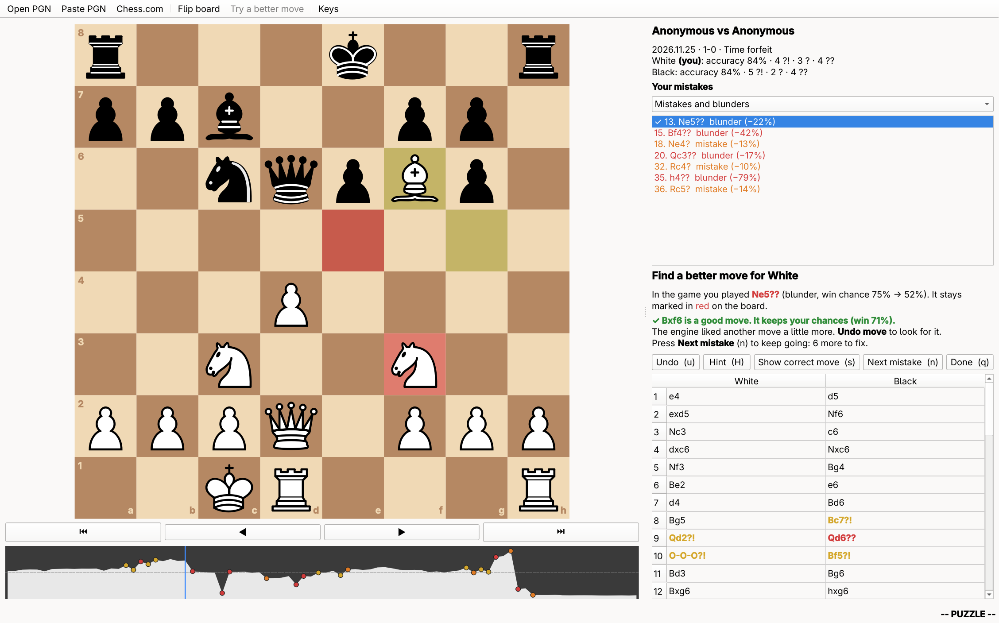

# chessCoach
Analyze my games and try to help me improve.

chessCoach runs your games through Stockfish, flags your inaccuracies, mistakes
and blunders, and lets you replay each one from that position until you find a
better move.



## Setup (Fedora)

```bash
sudo dnf install stockfish
python3 -m venv .venv
.venv/bin/pip install -e '.[gui,dev]'
```

If Stockfish is installed somewhere unusual, point to it with
`export CHESSCOACH_STOCKFISH=/path/to/stockfish`.

## Running the tests

```bash
.venv/bin/pytest
```

## Command line

```bash
.venv/bin/chesscoach-cli analyze my_game.pgn --user UsagiTengu   # flags your mistakes
.venv/bin/chesscoach-cli analyze my_game.pgn --json   # full analysis as JSON
```

Each position is searched for a fixed 200,000 nodes by a single-threaded
Stockfish (`--nodes`, optional `--depth` cap), so the same game always gets the
same verdicts. One engine runs per CPU core in parallel (`--engines`), and
results are cached in `~/.cache/chesscoach/analysis/` (keyed by the moves and
settings), so re-opening a game is instant; `--no-cache` re-analyzes.

Moves are judged like on Lichess: each position's evaluation is converted to a
win percentage, and a move that gives away at least 5 / 10 / 15 percentage
points versus the engine's best move is an inaccuracy (`?!`), mistake (`?`)
or blunder (`??`).

Each flagged move also gets its pattern tags in brackets, e.g.
`[Hung a piece, Time trouble]` (see [Pattern tags](#pattern-tags)).

With `--user`, your own inaccuracies, mistakes and blunders are also saved to
the mistake database (see below); `--no-save` skips that.

## Importing from Chess.com

```bash
.venv/bin/chesscoach-cli recent UsagiTengu --count 10              # list recent games
.venv/bin/chesscoach-cli recent UsagiTengu --count 10 --save games # also save .pgn files
```

This uses Chess.com's public API, so no login is needed. Chess variants are skipped.

### Analyze many games at once

```bash
.venv/bin/chesscoach-cli batch UsagiTengu              # your last 50 games
.venv/bin/chesscoach-cli batch UsagiTengu --count 200
```

Each game is analyzed (about 10 s each, instant if it is in the analysis
cache) and your mistakes are saved to the [mistake database](#mistake-database)
with their pattern tags. Games already saved are skipped, so you can stop with
Ctrl-C and run the same command again to continue. A game that fails is listed
at the end and the rest still run; `--redo` saves every game again.

### My top mistakes

```bash
.venv/bin/chesscoach-cli report                         # everything in the mistake database
.venv/bin/chesscoach-cli report --last 50 --time-control rapid
.venv/bin/chesscoach-cli report --since 2026-09-01 --by week
```

Counts your mistakes by pattern tag, by phase (opening / middlegame /
endgame, including the many mistakes that match no pattern), by time control
(per game) and by month, with the worst example positions for each. The best
move is never shown, and a "missed" tag only lists positions you have
already solved or revealed in a retry.

In the app, **My mistakes…** (Ctrl+R or `:report`) shows the same report;
click **Retry** next to an example to open that game straight into the puzzle.

### Practice deck

```bash
.venv/bin/chesscoach-cli deck            # puzzles due today, cards per box, what's coming up
```

Your mistakes and blunders come back as puzzles on a schedule (Leitner boxes:
1, 3, 7, 14, 30, 60 and 120 days). Ten new cards join the deck each day,
blunders first; inaccuracies and positions you were already losing are left
out. Finding a good move on your first try moves a card up a box, solving it
after a wrong try or a hint keeps it where it is, and revealing the answer
sends it back to tomorrow.

In the app, **Practice…** (Ctrl+P or `:practice`) goes through today's cards
one puzzle at a time, set up straight from the position: the same keys and
buttons as a retry, plus **Next card** (n). A card you missed comes back once
more at the end of the session (not graded). "Missed" tags stay hidden until
you solve or reveal the card in that review, and **Open the game** shows the
whole game afterwards.

The report (`chesscoach-cli report` and **My mistakes…**) ends with the deck:
cards per box, how often you found a good move on the first try (overall
and per pattern, to see whether e.g. "hung a piece" improves), and the
trouble cards you've missed three times or more.

## Desktop app

Add chessCoach to your Fedora app menu (this also sets up `.venv` if needed):

```bash
scripts/install-desktop.sh                # app menu entry + icon
scripts/install-desktop.sh --default-pgn  # also open .pgn files with chessCoach on double-click
scripts/install-desktop.sh --uninstall
```

Or run it directly: `.venv/bin/chesscoach [my_game.pgn]`.

Save games from Chess.com or Lichess as `.pgn` files ("Download PGN" on the game page).

Load a game from a `.pgn` file (Ctrl+O), pasted text (Ctrl+Shift+V), Chess.com
(Ctrl+I) or by dropping a file on the window. Stockfish analyzes it in the
background. You then get:

- an evaluation graph (click it to jump to any move),
- the move list colored by inaccuracy / mistake / blunder,
- **Your mistakes**: your errors only. Select one to see the position and the
  engine's best move. If your Chess.com username doesn't match either player,
  the app asks which side you played. Each one shows its
  [pattern tags](#pattern-tags), such as *Hung a piece · Time trouble*; a
  "missed" tag (*Missed fork*) only appears once you solve or reveal the puzzle,
  since it would give the answer away.

### Retry your mistakes

Pick one of your mistakes from the list. The board rewinds to the position
before you went wrong and becomes playable (click or drag). The move you
actually played stays tinted in its color (gold / orange / red) on the board. The answer stays
hidden: the best move appears nowhere until you ask for it.

- ✓ **Good or best move**: the mistake is ticked off. Use **Next mistake** to continue.
- ✗ **Still an error**: you see how much it costs and the opponent's best
  reply (red arrow). **Undo move** (Backspace) lets you try something else.
- **Preview before you move**: while you hold a piece (Space, click or drag), the
  square under the cursor or mouse shows a **blue arrow** and a see-through copy
  of the piece. The status bar spells it out, e.g. `Knight f3 → e5 (Ne5)`. Typing
  `:Ne5` previews the same way before you press Enter.
- **Hint** highlights the piece to move.
- **Show correct move** reveals the engine's move (green arrow) and line, and
  marks the mistake 👁 in the list.

You can also reach a puzzle by stepping to one of your bad moves and pressing **T**.

### Mistake database

Every inaccuracy, mistake and blunder **you** made is saved to a local SQLite
file, `~/.local/share/chesscoach/mistakes.sqlite3` (`$XDG_DATA_HOME` is
respected; set `CHESSCOACH_DB` to use another file). For each one it keeps
the position, your move, the engine's move and line, the opponent's best reply
to your move, the win % lost, the game link, date, time control and your clock. Every retry attempt and every
"Show correct move" is logged too; the `mistake_stats` view sums them up
(attempts / solved / revealed). Opening the same game again adds nothing.

```bash
sqlite3 ~/.local/share/chesscoach/mistakes.sqlite3 \
  "SELECT judgement, COUNT(*) FROM mistakes GROUP BY judgement"
```

### Pattern tags

Every saved mistake is tagged with simple rules (`chesscoach/tags.py`) that
read the engine's lines; they never judge a move themselves.

| What went wrong | What you missed | Context |
|---|---|---|
| Hung a piece | Missed capture | Opening (move ≤ 12) |
| Allowed mate | Missed fork / pin / skewer | Time trouble (clock < 10% of the start) |
| Back-rank weakness | Missed mate / back-rank mate | Already winning / losing (win % ≥ 75 / ≤ 25) |
| | | Endgame (after the opening: no queens, or ≤ 13 points of pieces each besides king and pawns) |

"What you missed" tags give the answer away, so the app only shows them once
a puzzle is solved or revealed. Every number the rules use is in
`TagThresholds` in `chesscoach/tags.py`.

Tags are stored in the `mistake_tags` table. To tag mistakes saved by an
older chessCoach (or retag after the rules change) and see how often each
tag comes up:

```bash
.venv/bin/chesscoach-cli tag              # one quick Stockfish search per old mistake
.venv/bin/chesscoach-cli tag --no-engine  # no Stockfish; may miss some tags
```

### Keyboard (vim-style)

Everything can be done from the keyboard. Press `?` in the app for the full list.

| Browsing | | Puzzle (retrying a mistake) | |
|---|---|---|---|
| `h` / `l` | previous / next half-move | `h` `j` `k` `l` | move the square cursor |
| `k` / `j` | up / down a full move | `Space` | pick up / drop a piece |
| `gg` / `G` | start / end (`12G` = move 12) | `:Nf3` | type a move (SAN or `e2e4`) |
| `5l`, `3j` | counts repeat a motion | `u` | undo your attempt |
| `n` / `N` | next / previous mistake (starts the puzzle) | `H` | hint |
| `t` / `Enter` | try a better move here | `s` | show the correct move |
| `c` | cycle the mistake filter | `q` / `Esc` | done |
| `f` | flip the board | `n` / `N` | next / previous mistake |
| `Esc` | cancel analysis | | |

`:` opens a command line at the bottom: `:e` open a file, `:paste`, `:cc` Chess.com,
`:q` quit, `:help`. Arrow keys, Home/End and the Ctrl shortcuts also work.
Single-letter keys are ignored while you type in a text box.

## Credits

chessCoach uses Stockfish, python-chess, PySide6 and the "cburnett" chess pieces.
See [CREDITS.md](CREDITS.md) for authors and licenses.

## License

Copyright (C) 2026 David Hampton

chessCoach is free software: you can redistribute it and/or modify it under the
terms of the GNU General Public License as published by the Free Software
Foundation, either version 3 of the License, or (at your option) any later
version. It is distributed in the hope that it will be useful, but WITHOUT ANY
WARRANTY; without even the implied warranty of MERCHANTABILITY or FITNESS FOR A
PARTICULAR PURPOSE. See [LICENSE](LICENSE) for the full text.
